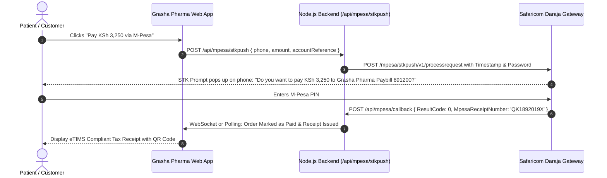

# 🚀 Grasha Pharma Web App & POS — Cloud Deployment & Integration Guide

Welcome to the production deployment guide for **Grasha Pharma E-Commerce & Pharmacy Point-of-Sale (POS)** with **Kenyan KRA eTIMS** and **Safaricom Lipa Na M-Pesa Daraja API**.

---

## 📋 Table of Contents
1. [Local Development Quickstart](#1-local-development-quickstart)
2. [Database Deployment (Supabase & Cloud MySQL)](#2-database-deployment-supabase--cloud-mysql)
3. [Cloud Web Hosting on Vercel](#3-cloud-web-hosting-on-vercel)
4. [Cloud Web Hosting on Netlify](#4-cloud-web-hosting-on-netlify)
5. [Safaricom Lipa Na M-Pesa Daraja Integration Checklist](#5-safaricom-lipa-na-m-pesa-daraja-integration-checklist)
6. [Kenyan KRA eTIMS Integration Architecture](#6-kenyan-kra-etims-integration-architecture)
7. [Environment Variables Reference](#7-environment-variables-reference)

---

## 1. Local Development Quickstart

### Prerequisites
- **Node.js**: v18 or newer
- **MySQL / MariaDB**: Running locally on `127.0.0.1:3306` (Credentials: `root` / `root`)

### Steps
```bash
# 1. Navigate to project directory
cd c:\Users\mwema\Downloads\medicine-ecommerce-app

# 2. Install dependencies
npm install

# 3. Setup and seed the MySQL database (creates grasha_pharma_db and 8 tables)
npm run db:setup

# 4. Start the Express API and Web App server
npm start
```
Visit the running application:
- **Customer Storefront**: [http://localhost:3000](http://localhost:3000)
- **Pharmacy POS & eTIMS Terminal**: [http://localhost:3000#pos](http://localhost:3000#pos)
- **Admin Dashboard & Sales Reports**: [http://localhost:3000#admin](http://localhost:3000#admin)
- **Lipa Na M-Pesa Simulator**: [http://localhost:3000#mpesa](http://localhost:3000#mpesa)

---

## 2. Database Deployment (Supabase & Cloud MySQL)

### Option A: Cloud MySQL (Recommended for Zero-Code-Change Deploy)
The backend is powered by Node.js `mysql2/promise`. The easiest cloud databases with 100% MySQL wire compatibility are:
- **Railway.app** (Click *New* -> *Database* -> *MySQL*)
- **Aiven.io** (Free tier MySQL)
- **PlanetScale** or **AWS RDS MySQL**

**Migration Steps for Cloud MySQL:**
1. Create a MySQL database instance on Railway or Aiven.
2. Note your connection details:
   - Host: e.g. `mysql.railway.internal` or `junction.proxy.rlwy.net`
   - Port: e.g. `3306` or assigned custom port
   - User: `root`
   - Password: `<your-db-password>`
   - Database: `railway` or `grasha_pharma_db`
3. Execute `database/schema.sql` and `database/seed.sql` using MySQL Workbench, DBeaver, or via the command line:
   ```bash
   mysql -h <host> -P <port> -u <user> -p <database> < database/schema.sql
   mysql -h <host> -P <port> -u <user> -p <database> < database/seed.sql
   ```

---

### Option B: Supabase (PostgreSQL Cloud)
[Supabase](https://supabase.com) is an open-source Firebase alternative powered by PostgreSQL with built-in Authentication and Storage.

#### 1. Create a Supabase Project
1. Log in to [supabase.com](https://supabase.com) and click **New Project**.
2. Name your project (e.g., `grasha-pharma-db`) and generate a secure database password.
3. Choose the region closest to Kenya (e.g., `eu-central-1` Frankfurt or `af-south-1` Cape Town).

#### 2. Execute SQL Schema in Supabase SQL Editor
1. In the Supabase Dashboard, go to the **SQL Editor** tab.
2. Copy the contents of `database/schema.sql` (adapted for PostgreSQL syntax if using direct PG driver, or use the Foreign Data Wrapper).
3. Supabase also offers instant REST endpoints (`https://<project-ref>.supabase.co/rest/v1/medicines`) that you can query directly with your `anon` key.

#### 3. Enable Google Sign-In via Supabase Auth
1. In the Supabase Dashboard, go to **Authentication** -> **Providers** -> **Google**.
2. Toggle **Enable Google provider**.
3. Enter your Google Cloud OAuth **Client ID** and **Client Secret**.
4. In your Google Cloud Console, add the Supabase Callback URL (`https://<project-ref>.supabase.co/auth/v1/callback`) to your Authorized redirect URIs.

---

## 3. Cloud Web Hosting on Vercel

Vercel provides instant global deployment for frontend static assets and serverless Node.js endpoints.

### Step 1: Push Code to GitHub
```bash
git init
git add .
git commit -m "feat: Grasha Pharma web app, POS, eTIMS, and Lipa Na M-Pesa"
git branch -M main
git remote add origin https://github.com/<your-username>/grasha-pharma.git
git push -u origin main
```

### Step 2: Import Project in Vercel
1. Go to [vercel.com](https://vercel.com) and click **Add New...** -> **Project**.
2. Select your `grasha-pharma` GitHub repository.
3. **Framework Preset**: Select `Other` (or leave default).
4. **Root Directory**: `./`

### Step 3: Configure Environment Variables
Under the **Environment Variables** section, add:
| Key | Example Value | Description |
|-----|---------------|-------------|
| `DB_HOST` | `junction.proxy.rlwy.net` | Cloud Database host |
| `DB_PORT` | `3306` | Cloud Database port |
| `DB_USER` | `root` | Database username |
| `DB_PASSWORD` | `<secure-password>` | Database password |
| `DB_NAME` | `grasha_pharma_db` | Database schema name |
| `GOOGLE_CLIENT_ID` | `8912048192-xxx.apps.googleusercontent.com` | Google Sign-In Client ID |
| `PORT` | `3000` | Port |

### Step 4: Deploy
Click **Deploy**. Vercel will use `vercel.json` to automatically serve:
- Frontend assets (`index.html`, `css/*`, `js/*`) via global edge CDN.
- Backend API endpoints (`/api/*`) via serverless Node.js lambdas.

---

## 4. Cloud Web Hosting on Netlify

### Step 1: Link Netlify to GitHub
1. Sign in to [netlify.com](https://netlify.com) and click **Add new site** -> **Import an existing project**.
2. Connect your GitHub repository.

### Step 2: Build and Deploy Settings
- **Publish directory**: `.`
- **Build command**: *(leave blank or `npm run build` if bundling)*
- Netlify reads `netlify.toml` automatically to route `/api/*` requests.

### Step 3: Add Netlify Environment Variables
Under **Site configuration** -> **Environment variables**, set `DB_HOST`, `DB_USER`, `DB_PASSWORD`, `DB_NAME`, and `GOOGLE_CLIENT_ID`.

---

## 5. Safaricom Lipa Na M-Pesa Daraja Integration Checklist

Grasha Pharma includes full architectural support for **Lipa Na M-Pesa Online (STK Push)**.

### Production Credentials Checklist
To take real payments in Kenya:
1. Register an account on [Safaricom Developer Portal (Daraja)](https://developer.safaricom.co.ke).
2. Create an App under **My Apps** with the **Lipa Na M-Pesa Online (LNMO)** product checked.
3. Safaricom will grant you:
   - **Consumer Key**: Used to generate OAuth bearer tokens.
   - **Consumer Secret**: Used to generate OAuth bearer tokens.
   - **Business Shortcode / Paybill**: Grasha Pharma uses `891200`.
   - **Passkey**: Base64 encryption key provided upon Paybill go-live approval.
4. Set your production callback URL (e.g., `https://your-domain.vercel.app/api/mpesa/callback`).

### How STK Push Works in Grasha Pharma:


---

## 6. Kenyan KRA eTIMS Integration Architecture

Under the **Kenya Tax Procedures (Electronic Tax Invoice) Regulations**, all VAT and non-VAT registered businesses issuing invoices or receipts must transmit real-time sales data to KRA's eTIMS server.

### Grasha Pharma Fiscal Rules:
1. **Human Medicines (Exempt - Code E)**:
   - Governed by the **VAT Act (First Schedule)**: prescription and OTC pharmaceutical medicines for human use are VAT-exempt (0% VAT).
   - Invoices indicate: `Tax Code: E (Exempt)`, `VAT Amount: KSh 0.00`.
2. **Medical Diagnostics & Supplements (Standard - Code A)**:
   - Diagnostic devices (blood glucose monitors, digital BP cuffs) and non-medicinal nutritional supplements attract **16% Standard VAT**.
   - Invoices calculate: `Taxable Amount = Gross / 1.16`, `VAT 16% = Gross - Taxable`.
3. **Receipt Requirements on Printout**:
   - Trader KRA PIN (e.g. `P051289120Z`)
   - Control Unit (CU) Serial (e.g. `KRAMW0921804`)
   - eTIMS Invoice Number (e.g. `ETIMS-GP-2026-98214`)
   - SCDC (Sales Data Controller Code)
   - Printable QR Code pointing to `https://etims.kra.go.ke/verify?invoice=...`

---

## 7. Environment Variables Reference

| Variable | Default Value | Description |
|----------|---------------|-------------|
| `PORT` | `3000` | Port for the Express server |
| `DB_HOST` | `127.0.0.1` | MySQL host (use `127.0.0.1` for local TCP) |
| `DB_PORT` | `3306` | MySQL port |
| `DB_USER` | `root` | Database username |
| `DB_PASSWORD` | `root` | Database password |
| `DB_NAME` | `grasha_pharma_db` | Database name |
| `GOOGLE_CLIENT_ID` | `8912048192-grashapharma.apps.googleusercontent.com` | Google OAuth Client ID |
| `MPESA_ENVIRONMENT` | `sandbox` | `sandbox` or `production` |
| `MPESA_PAYBILL` | `891200` | Safaricom Shortcode / Paybill |
| `KRA_PIN` | `P051289120Z` | Pharmacy KRA PIN |
| `KRA_CU_SERIAL` | `KRAMW0921804` | KRA Control Unit Device Serial Number |

---
*Developed for Grasha Pharma Ltd. Licensed by Pharmacy and Poisons Board Kenya (PPB Reg #3912).*
